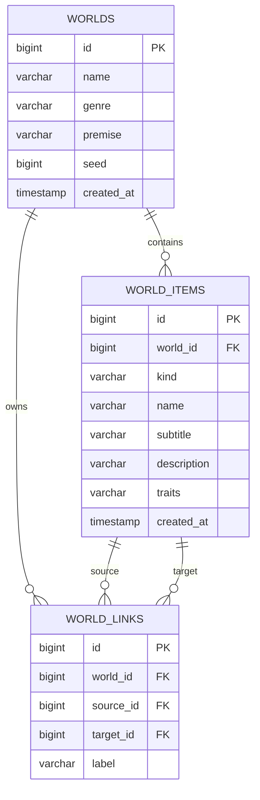

# Mythos Forge — Project Report

> Replace the bracketed fields with your details and adapt the report to your college's required format. Add screenshots from your own run before submission.

## Title page

**Project title:** Mythos Forge — Fantasy Worldbuilding Studio  
**Submitted by:** [Student name]  
**Roll number:** [Roll number]  
**Programme:** Bachelor of Computer Applications (BCA)  
**College:** [College name]  
**Project guide:** [Guide name]  
**Academic year:** [Academic year]

## Abstract

Mythos Forge is a browser-based application for creating and organizing fictional fantasy worlds. A user can create multiple worlds, record structured lore as realms, characters, creatures, quests, and relics, and define relationships between those records. The application includes a repeatable starter-content generator, search and category filters, a relationship map, and JSON export. A Java REST service built with Spring Boot handles application logic and communicates with an H2 relational database through Spring Data JPA. The frontend uses HTML, CSS, and JavaScript. The project demonstrates object-oriented programming, web application architecture, REST APIs, database design, validation, and basic graph visualization.

## 1. Introduction

Fantasy settings are often documented across separate notes, making it difficult to understand how people, places, and events relate. Mythos Forge provides one structured workspace where these details can be created, connected, searched, and exported. Its fictional domain keeps the application self-contained while giving the student opportunities to demonstrate database operations and graph relationships.

## 2. Problem statement

When worldbuilding details are kept in unstructured notes, names and facts can become inconsistent and relationships are difficult to inspect. The project provides a structured digital codex with linked records and repeatable starter content.

## 3. Objectives

- Build a Java web application with a clear separation between interface, API, service, and persistence layers.
- Store multiple fictional worlds and their records in a relational database.
- Support create, read, update, and delete operations for world entries.
- Represent connections between entries and display them as a graph.
- Generate repeatable starter lore using a numeric seed.
- Provide search, category filtering, statistics, and JSON export.

## 4. Scope

The project supports a single local user working with worlds stored on one computer. Each world contains realms, characters, creatures, quests, and relics. Users can create connections between entries, browse those connections in a graph view, and export a JSON snapshot. Authentication, collaborative editing, cloud synchronization, image uploads, and publishing are outside the initial scope.

## 5. System requirements

### Hardware

- Dual-core processor or better
- 4 GB RAM recommended
- 200 MB of free disk space for the application and database

### Software

- Java Development Kit 17 or later
- Apache Maven 3.6.3 or later
- Modern browser
- Windows, macOS, or Linux

## 6. Technology stack

| Layer | Technology | Responsibility |
|---|---|---|
| Frontend | HTML, CSS, JavaScript | Forms, codex cards, filters, statistics, and relationship map |
| Web/API | Java and Spring Boot | HTTP server, REST routes, request validation, service orchestration |
| Persistence | Spring Data JPA | Repository operations and object-relational mapping |
| Database | H2 | Persistent local relational database |
| Build | Maven | Dependency management and application launch |

## 7. Main modules

1. **World management:** creates and lists separate worlds, each with a genre, premise, and generation seed.
2. **Lore management:** adds, edits, displays, searches, filters, and deletes five kinds of world records.
3. **Starter generator:** creates a seeded set of sample entries and connections for a new world.
4. **Relationship manager:** connects two entries in the same world and removes related connections when an entry is deleted.
5. **Map and dashboard:** summarizes record counts and visualizes connections as a node-and-edge graph.
6. **Export:** downloads a portable JSON representation of the selected world.

## 8. System design

The browser sends JSON requests to the Java REST API. The controller accepts requests and returns responses, the service layer validates world ownership and applies generation rules, and Spring Data repositories persist the entities in H2.

```text
Browser (HTML / CSS / JavaScript)
                │ JSON over HTTP
                ▼
       Spring MVC REST API
                │
                ▼
       WorldService rules
                │
                ▼
    Spring Data JPA repositories
                │
                ▼
          H2 relational DB
```

## 9. Database design

### Entity relationship diagram



### Table summary

- **worlds:** one row per created fictional setting.
- **world_items:** one row per realm, character, creature, quest, or relic. `world_id` identifies its parent world.
- **world_links:** one row per directed story relationship. `source_id` and `target_id` point to entries and `label` describes their connection.

## 10. Generation algorithm

1. Read the world's numeric seed.
2. Initialize Java's pseudorandom number generator from that seed.
3. Select a name and story details from fixed content pools for each entry type.
4. Save the generated entries and retain their database identifiers.
5. Create relationship records between selected entries.
6. Return the updated world, entry list, and connections to the browser.

When a world contains entries already, the generator returns its current contents instead of overwriting them. A fixed seed makes the generated name choices repeatable.

## 11. Validation and data integrity

World and entry requests are checked for required fields and maximum lengths. Entry types are restricted to five supported values. Before a connection is created, the service confirms both entries exist in the selected world and are different records. Relational foreign keys protect database references. Removing an entry removes its connections first.

## 12. Installation and execution

1. Install JDK 17+ and Maven.
2. Extract the project ZIP.
3. Open a terminal in the extracted `mythos-forge` directory.
4. Run `mvn spring-boot:run` (or run `run.bat` on Windows).
5. Open `http://localhost:8080` in a browser.

The first run requires internet access for Maven to download dependencies. The H2 database persists in `data/mythosforge.mv.db`.

## 13. Evaluation checklist

Use these scenarios during your own demonstration and record the results required by your college:

| Scenario | Expected result |
|---|---|
| Start the app for the first time | A sample world and starter lore are available |
| Create a second world | It appears in the sidebar and can be selected |
| Add, edit, and delete an entry | The codex and counts update; removed entry links disappear |
| Search for an entry | Matching lore is shown; unrelated entries are filtered out |
| Connect two entries | The relationship appears in the map and detail view |
| Generate lore using a fixed seed | The starter names are repeatable for the same seed |
| Export the selected world | A JSON file contains world, entries, and connections |

## 14. Limitations

The app is designed as a local academic prototype. It has no authentication, multi-user access, online storage, image uploads, or collaborative editing. The starter generator uses small fixed pools rather than an external AI service. The database console is intended only for local demonstration.

## 15. Future enhancements

- Add user accounts and permissions.
- Add timeline events and branching quest outcomes.
- Allow custom entry types and configurable relationship labels.
- Add image and map artwork uploads with safe storage.
- Add automated tests and a downloadable PDF report after the college's required format is known.

## 16. Conclusion

Mythos Forge combines a Java backend, REST API, relational database, and browser interface in a single project. Its CRUD workflows, validation, seeded generation, and relationship graph provide a practical demonstration of BCA-level programming and database concepts within a fictional worldbuilding theme.

## References

- Spring Boot Reference Documentation: <https://docs.spring.io/spring-boot/reference/>
- Spring Data JPA Reference: <https://docs.spring.io/spring-data/jpa/reference/>
- H2 Database: <https://www.h2database.com/>
- MDN Web Docs — HTML, CSS, and JavaScript: <https://developer.mozilla.org/>
